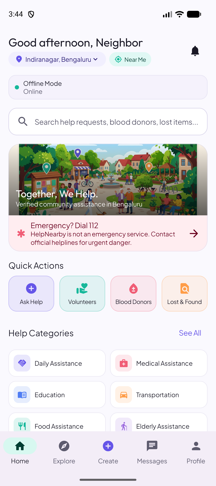
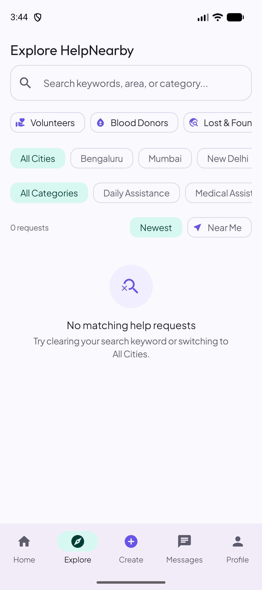
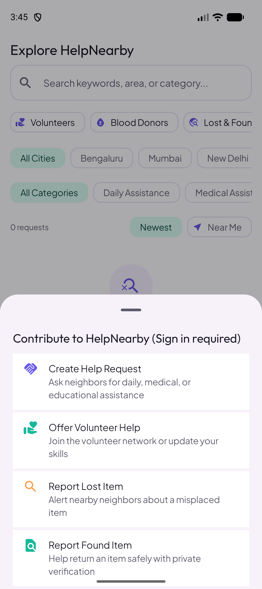
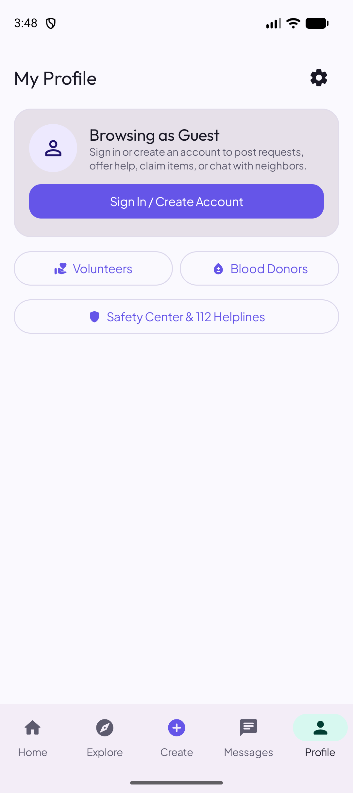

<div align="center">

  <h1>🤝 HelpNearby — <i>"Together, We Help."</i></h1>
  <p><b>Hyper-Local, Offline-First Community Assistance & Mutual Aid Platform for India</b></p>

  [](https://kotlinlang.org/)
  [](https://developer.android.com/jetpack/compose)
  [](https://m3.material.io/)
  [](https://developer.android.com/)
  [](https://developer.android.com/)
  [](https://developer.android.com/topic/architecture)

</div>

---

## 📱 App Screenshots

| **Home Dashboard** | **Explore & Filters** | **Create & Contribute** | **Profile & Safety** |
|:---:|:---:|:---:|:---:|
|  |  |  |  |
| *Personalized greeting, emergency helplines, quick actions, categories* | *Multi-city search, category filters, distance sorting* | *Post requests, offer volunteer aid, report lost/found items* | *Profile management, volunteer status, India 112 Safety Center* |

---

## ✨ Key Features

### 🆘 1. Hyper-Local Help Requests
- **Categories:** Daily Assistance, Medical Aid, Education, Transportation, Food Assistance, Elderly Support.
- **Lifecycle:** `Open` ➔ `Offer Received` ➔ `Accepted` ➔ `In Progress` ➔ `Completed` / `Cancelled`.
- **Location Aware:** Filter requests by city (Bengaluru, Mumbai, Delhi) or sort by approximate distance using `ACCESS_COARSE_LOCATION`.

### 🩸 2. Private Blood Donor Directory
- **Opt-In Network:** Voluntary donor registration covering blood groups (`A+`, `A-`, `B+`, `B-`, `O+`, `O-`, `AB+`, `AB-`).
- **Privacy First:** Contact details & exact addresses are never publicly visible; requests are routed securely through private messaging.

### 📦 3. Lost & Found Network
- **Item Recovery:** Post lost or found items with zero-permission **Android Photo Picker** (`PickVisualMedia`).
- **Verification:** Hidden verification hints visible only to the item owner for safe claim verification.

### 🙋 4. Volunteer Directory
- Skill-based volunteer matching and real-time availability toggles (`Available` / `Busy`).
- Community feedback & honest verification badges.

### 💬 5. Private 1-to-1 Chat
- Unlocked automatically upon mutual request offer acceptance.
- Features blocking, reporting, and full participant privacy.

### 🚨 6. Emergency & Safety Center
- Clear disclaimer: *HelpNearby is a community assistance app, not an emergency response service.*
- One-tap direct dialer for India's national emergency hotline **112** and official helplines.
- Interactive personal safety checklist.

### 🌐 7. Offline-First & WorkManager Auto Sync
- **Local Source of Truth:** Instant UI reactivity backed by local **Room Database**.
- **Mutations Queue:** Offline actions are stored in `PendingSyncOperationEntity` and synced reliably via **WorkManager** `OfflineSyncWorker` when connectivity resumes.

---

## 🛠️ Tech Stack & Libraries

- **Language:** 100% Kotlin with Coroutines & Flow
- **UI Framework:** Jetpack Compose, Material Design 3, Compose Navigation
- **Dependency Injection:** Hilt
- **Local Persistence:** Room DB (18 Entities & DAOs), Preferences DataStore
- **Async & Backgrounding:** WorkManager (Background Sync), Kotlin Flow & StateFlow
- **Network & Backend:** Supabase (PostgREST, GoTrue Auth, Realtime) / Retrofit, OkHttp, Ktor
- **Security:** Jetpack Credential Manager, Android Photo Picker (zero storage permissions required)

---

## 🏗️ Project Architecture

```text
app/src/main/java/com/example/
├── HelpNearbyApplication.kt
├── MainActivity.kt
└── helpnearby/
    ├── core/
    │   ├── common/          # Validators, distance math, bilingual strings
    │   ├── database/        # Room Database (18 entities), DAOs, Seeder
    │   ├── designsystem/    # Brand theme (#6555E8, #16B89A, #FF9D48, #F05D76), fonts, M3 components
    │   ├── navigation/      # Type-safe @Serializable routes
    │   ├── network/         # BackendConfig & ConnectivityManager NetworkMonitor
    │   ├── security/        # Ownership, participant-only chat, rate limiting, admin guard
    │   └── sync/            # SyncManager & Hilt OfflineSyncWorker
    ├── data/
    │   ├── local/           # PreferencesDataStore & Entity-Domain mappers
    │   ├── remote/          # Firebase, Supabase (Retrofit), and FCM placeholders
    │   └── repository/      # Offline-first Room repository implementations
    ├── di/                  # Hilt DatabaseModule, NetworkModule, RepositoryModule
    ├── domain/
    │   ├── model/           # Clean Kotlin domain models & enums
    │   └── repository/      # Clean repository interfaces
    └── feature/             # auth, onboarding, home, explore, requests, volunteers,
                             # donors, lostfound, community, messaging, notifications,
                             # safety, profile, settings
```

---

## 🚀 Getting Started

### Prerequisites
- **Android Studio:** Ladybug or newer
- **JDK:** Version 17
- **Android SDK:** API 36 (Minimum SDK: 26)

### Option 1: Offline Local Mode (Room DB)
Clone the repository and run immediately. No API keys required!
HelpNearby automatically operates in **Offline Local Mode** backed by Room database persistence.

```bash
git clone https://github.com/YOUR_USERNAME/helpnearby.git
cd helpnearby
```

### Option 2: Live Supabase Backend Mode
To enable live authentication, realtime sync, and cloud database:
1. Follow the step-by-step setup in [`docs/SETUP_BACKEND.md`](docs/SETUP_BACKEND.md).
2. Execute [`docs/SUPABASE_SCHEMA.sql`](docs/SUPABASE_SCHEMA.sql) in your Supabase SQL Editor.
3. Add your credentials to `.env`:
   ```env
   SUPABASE_URL=https://YOUR_PROJECT_REF.supabase.co
   SUPABASE_ANON_KEY=YOUR_SUPABASE_ANON_KEY
   GOOGLE_WEB_CLIENT_ID=YOUR_WEB_CLIENT_ID.apps.googleusercontent.com
   ```

---

## 🧪 Testing

Run unit, Robolectric, Room, security, sync, and Compose UI journey tests:

```bash
# Run unit & integration tests on JVM
./gradlew :app:testDebugUnitTest
```

### Documentation Links
- 📘 [Backend Setup Guide (`docs/SETUP_BACKEND.md`)](docs/SETUP_BACKEND.md)
- 🗄️ [Supabase SQL Schema (`docs/SUPABASE_SCHEMA.sql`)](docs/SUPABASE_SCHEMA.sql)
- 🔒 [Firestore Rules & Schema (`docs/FIRESTORE_RULES_AND_SCHEMA.md`)](docs/FIRESTORE_RULES_AND_SCHEMA.md)
- 🧪 [Testing Guide (`docs/TESTING.md`)](docs/TESTING.md)

---

<div align="center">

  Made with ❤️ for communities in India • <b>HelpNearby</b>

</div>
